# OnlineEthnicClothing
民族服饰在线销售系统 系统亮点：AI 智能客服、协同过滤推荐、支付宝支付、物流快递api、ECharts 运营数据看板、店铺与商品双重审核、SKU 库存校验、优惠券结算；角色:用户、商家、管理员；

所有源码均本人开发，项目是前后端分离的，所有的项目都具备了完整的业务逻辑，不仅仅局限于基础的增删改查（CRUD）操作，系统亮点众多。

本文注重于计算机毕业设计选题指导，列出题目均有源码， 大家可以去【公众号】(毕业终点站)获取或者加我【qq】(2112698948)提意见(别忘记Star哟)。备注：git

声明：仅用于学习使用，请勿用于任何商业行为！

1.系统非商用，非开源，非无偿。

2.由本人开发，如需源码，请联系以下方式，qq:2112698948。

3.项目有很多，并未全部上传，如果未找到想要的，可直接咨询。
# D6098 民族服饰线上商城

> 面向用户、商家与管理员的民族服饰电商商城，覆盖「商家入驻—店铺审核—商品上架—商品浏览—加入购物车—优惠结算—在线支付—发货物流—确认收货—评价售后—内容运营—数据分析」的完整链路。

## 一、技术架构

| 层级 | 主要技术与职责 |
| :--- | :--- |
| 前端应用 | Vue 3、Vite、Vue Router、Pinia、Element Plus、Axios、ECharts；提供用户购物门户，以及管理员、商家共用的经营管理工作台，并通过路由守卫区分前后台访问。 |
| 服务端 | Spring Boot 3、Spring MVC、MyBatis-Plus、MySQL、Java 17；提供 REST 接口、分页查询、商品与订单业务处理、文件上传和数据持久化能力。 |
| 认证与通用能力 | java-jwt、请求拦截器、统一响应、全局异常处理、Excel 导入导出和操作日志；登录后签发 JWT，服务端解析当前用户和角色，前端据此进入用户端或管理端。 |
| 交易与智能能力 | 支付宝支付、第三方物流查询、ECharts、DeepSeek 兼容模型与 LangChain4j；用于在线支付、物流轨迹展示、运营图表、民族服饰知识问答和智能客服回复。 |

## 二、系统亮点

1. AI 智能客服
2. 协同过滤推荐
3. 支付宝支付
4. 物流快递 API
5. ECharts 运营数据看板
6. 店铺与商品双重审核
7. SKU 库存校验
8. 优惠券结算

## 三、功能模块与截图

> 截图存放于仓库 `images/` 目录，不依赖外部图床。

### 3.0 平台总览

**图 1 · 平台总览**：商城整体界面概览，涵盖购物门户与管理端入口。

### 3.1 用户端

**图 2 · 首页**：民族服饰商城首页，商品推荐与分类导航。

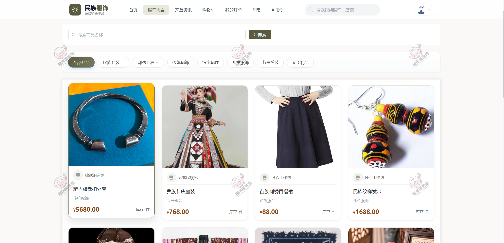

**图 3 · 服饰大全**：服饰分类浏览与筛选列表。

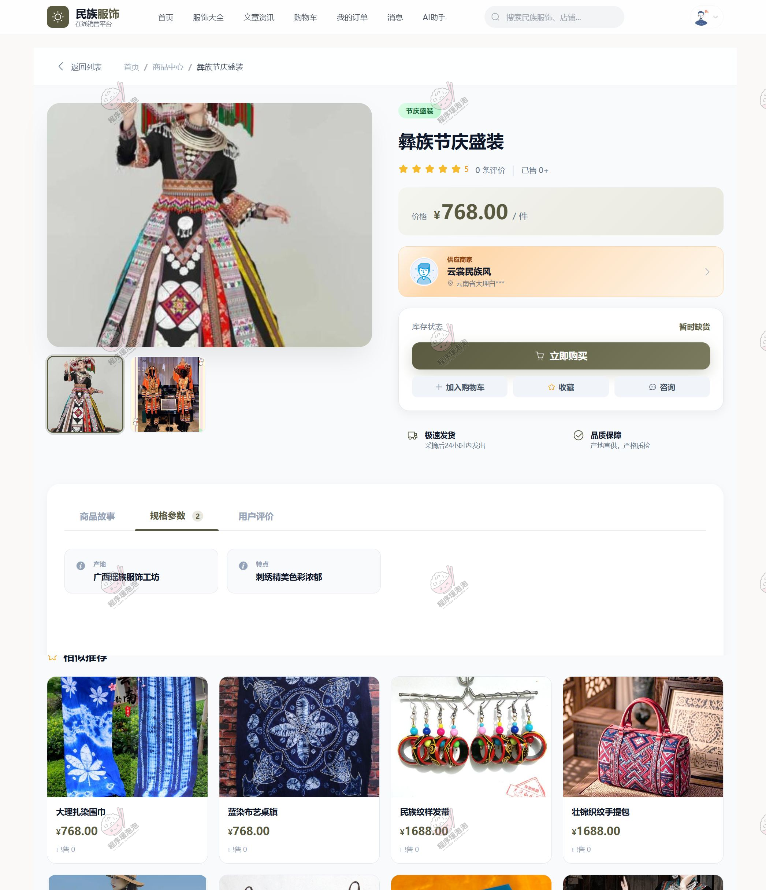

**图 4 · 服饰详情**：商品详情，含规格 SKU、库存与下单。

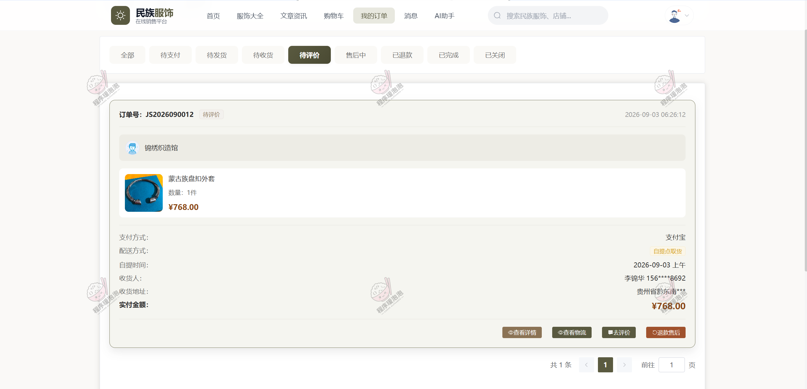

**图 5 · 我的订单**：个人订单管理与售后进度。

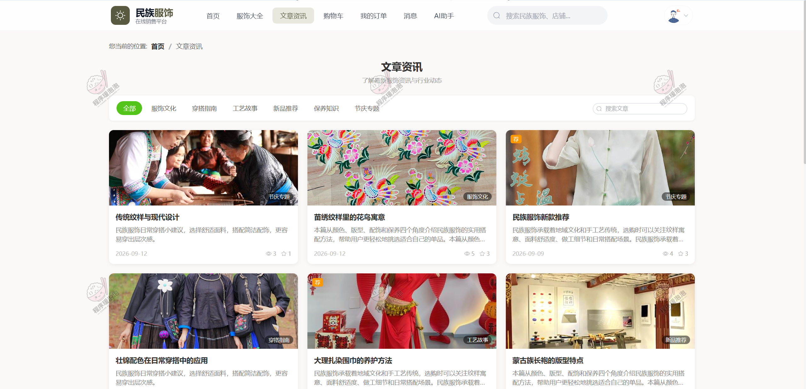

**图 6 · 文章资讯**：民族服饰资讯文章内容流。

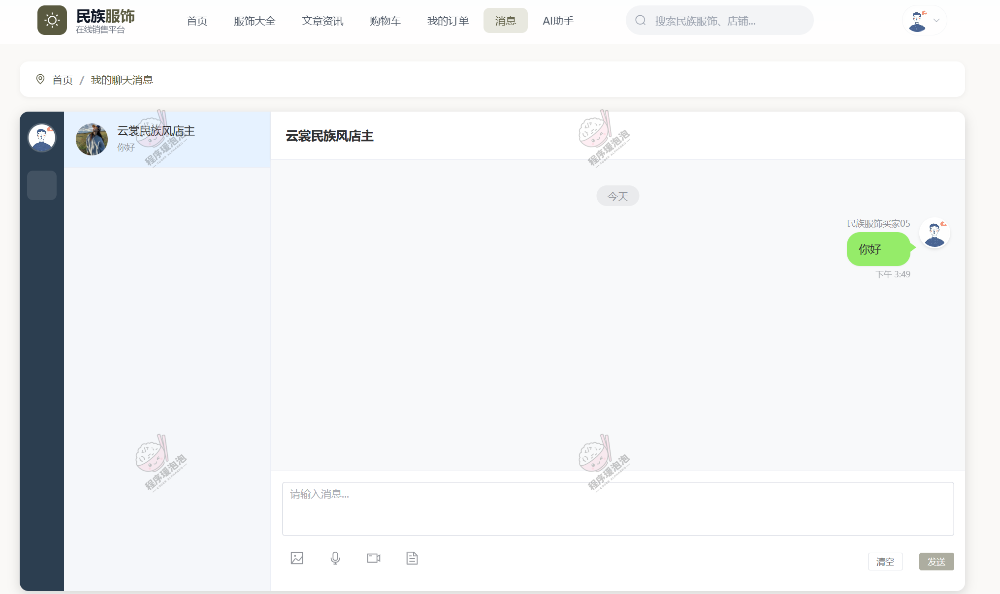

**图 7 · 联系商家**：用户与商家的消息沟通窗口。

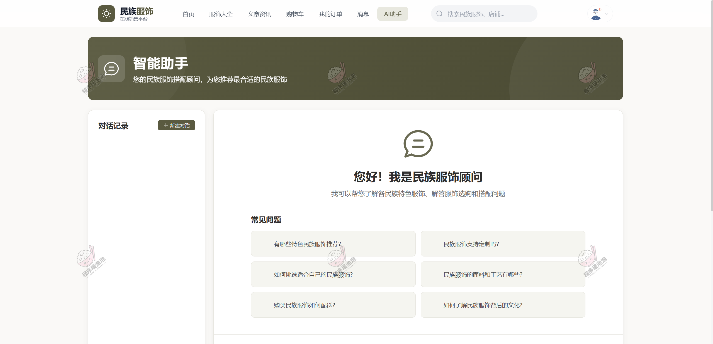

**图 8 · AI助手**：基于知识库的智能客服问答。

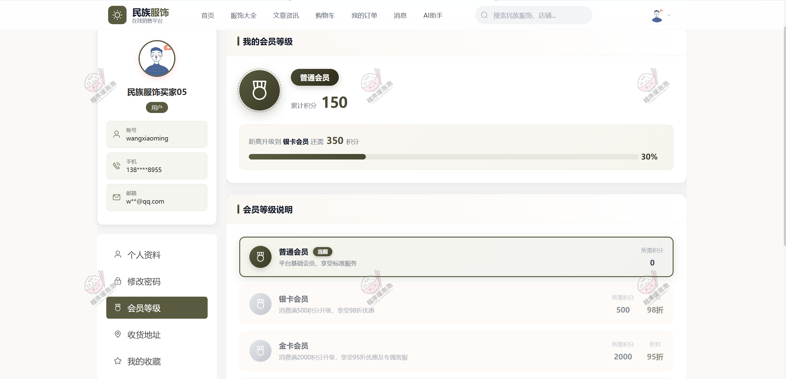

**图 9 · 个人中心**：会员信息、收藏与账户设置。

### 3.2 商家端

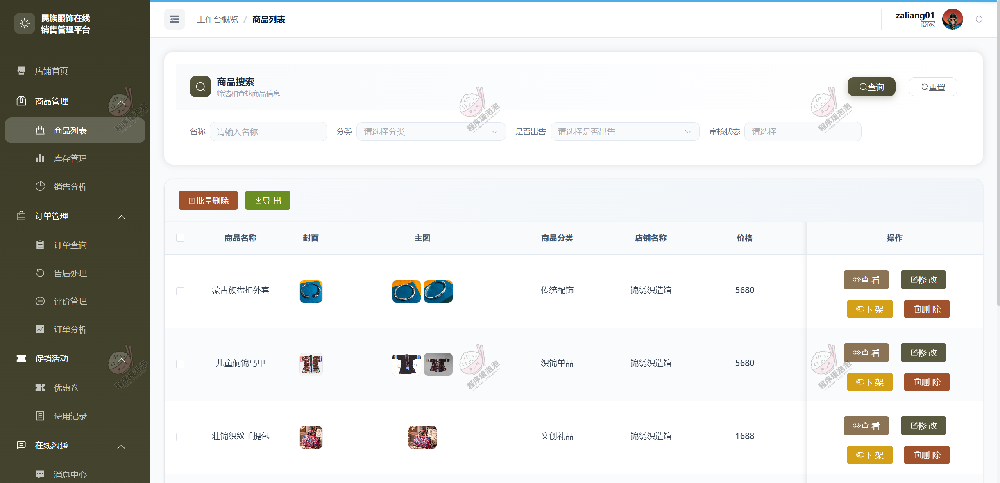

**图 10 · 商品列表**：商家商品维护与上下架管理。

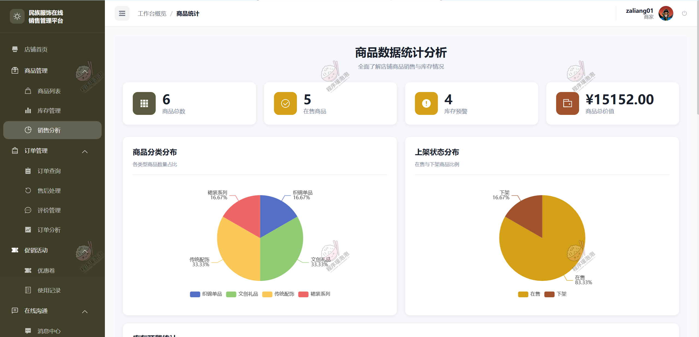

**图 11 · 销售分析**：商家销售数据看板。

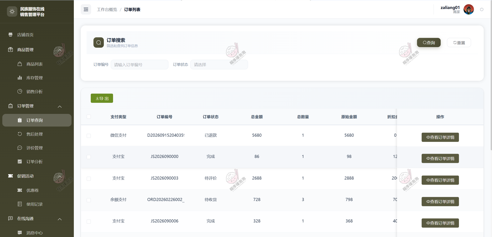

**图 12 · 订单处理**：商家订单发货与处理。

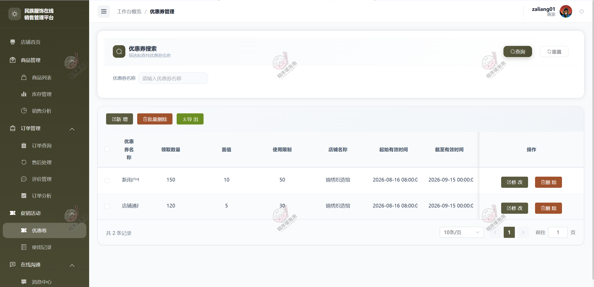

**图 13 · 优惠券**：优惠券配置与发放。

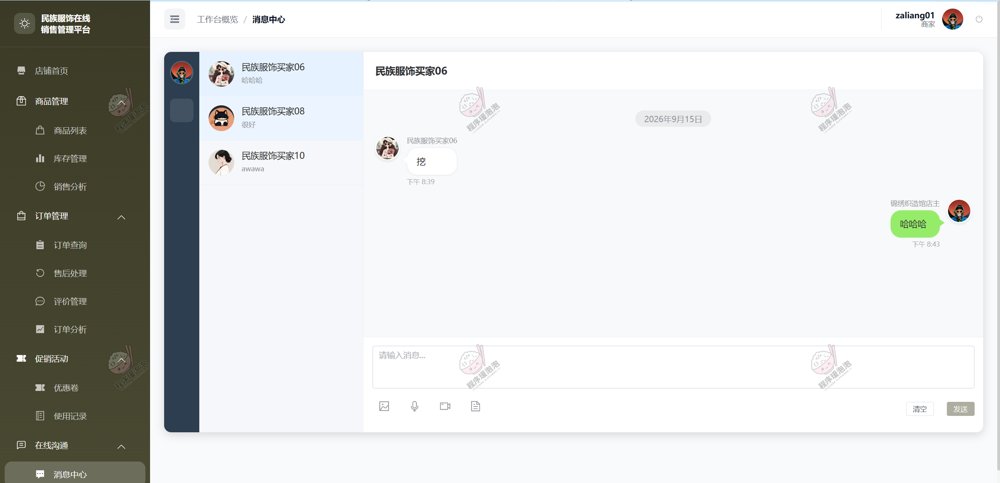

**图 14 · 消息中心**：商家消息与通知管理。

### 3.3 管理员端

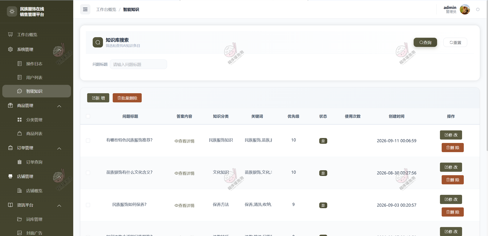

**图 15 · 智能知识**：平台 AI 知识库维护。

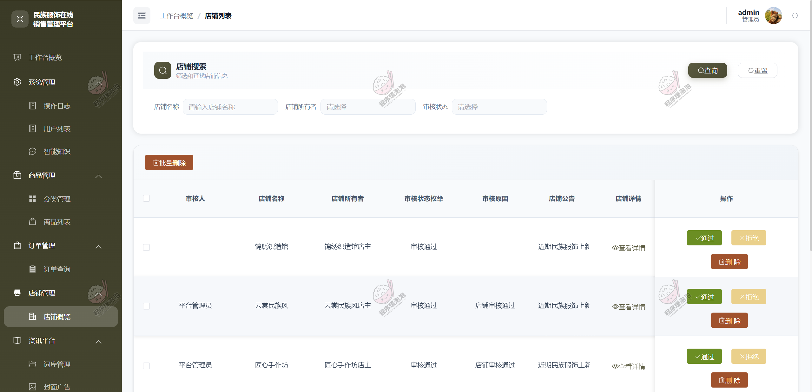

**图 16 · 店铺概述**：店铺审核与平台概览。

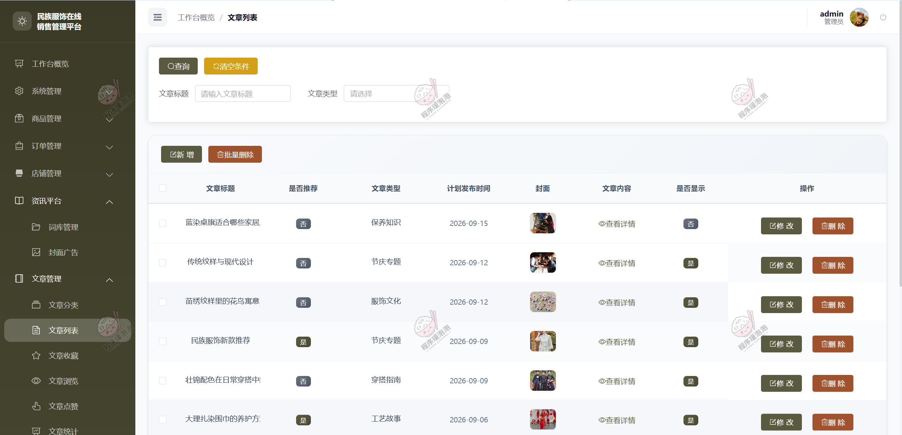

**图 17 · 文章列表**：资讯文章审核与管理。

## 说明

- 本文档中的界面截图均来自项目演示环境，仅用于功能展示与学习参考。
- 本项目仅用于学习交流，非商用、非开源、非无偿。
- 文档展示 17 张截图，需要了解更多，请联系我。
